<div align="center">

  <h3><code>yatin@gtm ~ $ ./contributions.sh</code></h3>
  

  <br><br>

  <h3><code>yatin@gtm ~ $ whoami</code></h3>
  <table>
    <tr>
      <td valign="top" width="370">
        
      </td>
      <td valign="top" width="490">
        
      </td>
    </tr>
  </table>

</div>

---

### <code>yatin@gtm ~ $ cat about.md</code>

> **I bridge commercial go-to-market strategy with event-driven technical execution.**

With a background in Business Administration (BBA) and frontline sales discovery, I don't build software in a vacuum—I build systems to solve concrete revenue bottlenecks. My focus is on **GTM Engineering, Revenue Automation, and AI Workflows**: transforming raw customer intent signals into structured data, deterministic lead qualification, enrichment waterfalls, and clean CRM routing.

```
[Inbound Intent] ──▶ [Deduplication] ──▶ [Enrichment Waterfall] ──▶ [Gated LLM Scoring] ──▶ [CRM Task & Sync]
  Webhooks / PLG       Supabase PG            Clay Callback            Deterministic Filter      HubSpot Routing
```

---

### <code>yatin@gtm ~ $ ./selected_builds.sh</code>

#### 1. Revenue Lifecycle Orchestration Engine (RLOE)
*Event-Driven Revenue Workflow & Automation Pipeline • Portfolio Project*

An automated revenue architecture built to qualify, enrich, score, and route inbound leads with minimum human friction and maximum data integrity:
- **Inbound Ingestion**: Ingests visitor intent signals via inbound webhooks and periodic PLG usage polling; normalizes payloads with custom JavaScript transforms and filters public email domains.
- **Cache-First Deduplication**: Queries Supabase PostgreSQL before external enrichment. Returning accounts update existing records and queue HubSpot tasks; net-new accounts reserve a row to prevent duplicate enrichment calls.
- **Waterfall Enrichment**: Triggers Clay enrichment with callback webhook listeners to pull firmographic and technographic data asynchronously.
- **Deterministic Pre-Scoring & Gated LLM Analysis**: Applies strict rule-based filters (ICP criteria, domain matching) before invoking expensive LLM APIs (NVIDIA-hosted Nemotron), ensuring models only run on high-potential leads with structured JSON output validation.
- **CRM Sync & Error Telemetry**: Routes leads by computed score into prioritized HubSpot CRM actions, logging run metrics and errors to dedicated telemetry tables (`inbound_intent_log`, `rloe_telemetry`, `system_error_log`).
- **Validated Single Run Benchmark**: Tested against single-lead execution (`linear.app`, execution 476): HTTP 200, pre-filter score 100, ICP score 95, intent score 85, routed to `sales_priority` with 374 input / 28 output tokens (~$0.000129 estimated model cost). *(Test execution data, not production scale).*

*Stack: n8n • Supabase PostgreSQL • Clay • HubSpot • NVIDIA LLM API • JavaScript*  
*(Note: Source repository is private; architecture documentation and workflow demo available upon request.)*

---

#### 2. JARVIS OS — Personal AI Desktop Assistant
*Desktop AI Assistant Prototype • In Development*

A modular personal AI workstation prototype built with a desktop shell:
- **Architecture**: React, TypeScript, and Vite front end wrapped inside a lightweight Tauri desktop shell, communicating with an Express proxy layer for secure AI provider orchestration.
- **Iterative Engineering**: Built systematically feature-by-feature using AI-assisted pair programming, validating every generated module against real runtime behavior and console logs.
- **Runtime Diagnostics**: Diagnosed and mitigated API rate limits, background prompt repetition loops, and voice/TTS integration latencies.

*Stack: React • TypeScript • Vite • Tauri • Node.js / Express*  
*(Note: Active development prototype; repository is private.)*

---

### <code>yatin@gtm ~ $ ./stack.sh</code>

```bash
[GTM Systems]     ICP & Intent Scoring | Deduplication | Lead Routing | Enrichment Waterfalls | Telemetry
[Automation & DB] n8n Workflows | Webhooks | REST/HTTP APIs | Supabase PostgreSQL | HubSpot CRM | Clay
[Front & Back]    JavaScript (ES6+) | TypeScript | React | Vite | Node.js / Express | Tauri
[Tools & Habits]  Git/GitHub | Postman | Cursor / Claude / Antigravity | Linux Terminal | Claude Code
```

---

### <code>yatin@gtm ~ $ ./experience.sh</code>

- **Independent AI Agent & Website Projects** *(Self-directed, 2024 – Present)*  
  Ran cold outreach, discovery conversations, and objection handling for local businesses; converted conversations into 6–7 delivered AI agent and automated web solutions.
- **Intern — Sales & Customer Discovery** *(Maruti Suzuki NEXA, June 2025 – August 2025)*  
  Handled 15–25 walk-in prospects daily, conducted product walkthroughs, qualified buyers in a target-driven sales environment, and managed CRM handoffs.
- **Education: Bachelor of Business Administration (BBA)**  
  *Amrapali University, Haldwani (2023 – 2026)*

---

### <code>yatin@gtm ~ $ ./contact.sh</code>

```
┌────────────────────────────────────────────────────────────────────────┐
│  GitHub    : https://github.com/yatinjoshi05                           │
│  LinkedIn  : https://www.linkedin.com/in/yatin-joshi-86a814363/        │
│  Email     : yatinjoshi972@gmail.com                                   │
│  Location  : Haldwani, Uttarakhand, India                              │
│  Status    : Open for Entry-Level GTM Engineering & RevOps Roles       │
└────────────────────────────────────────────────────────────────────────┘
```

<div align="center">
  <sub>Generated with terminal-style SVG architecture. Built with intention.</sub>
</div>
